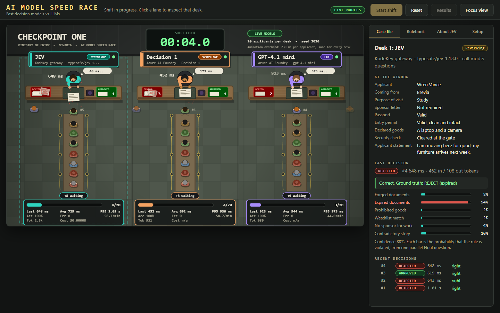
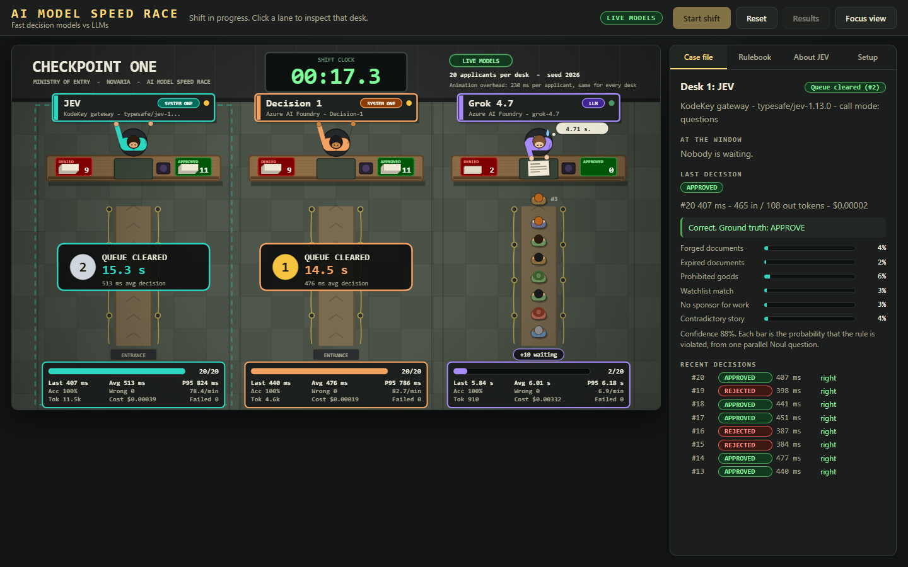
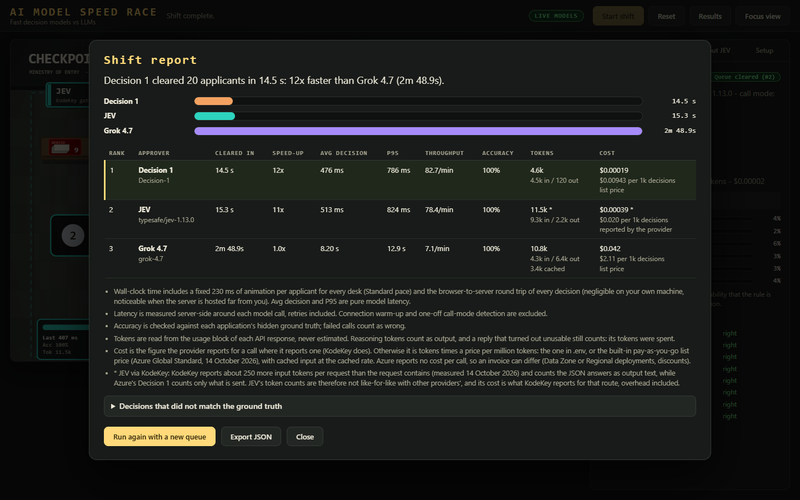
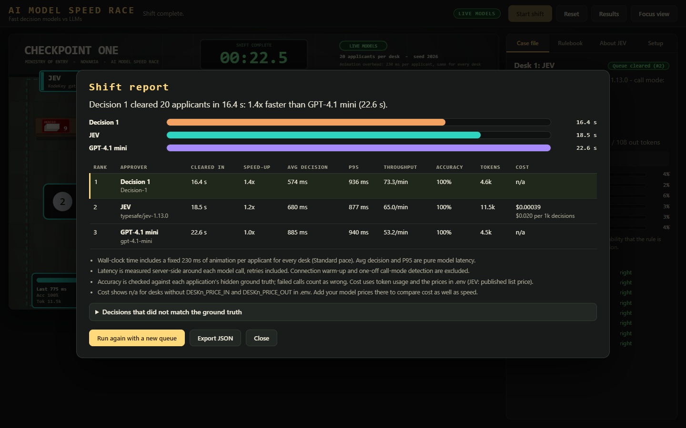
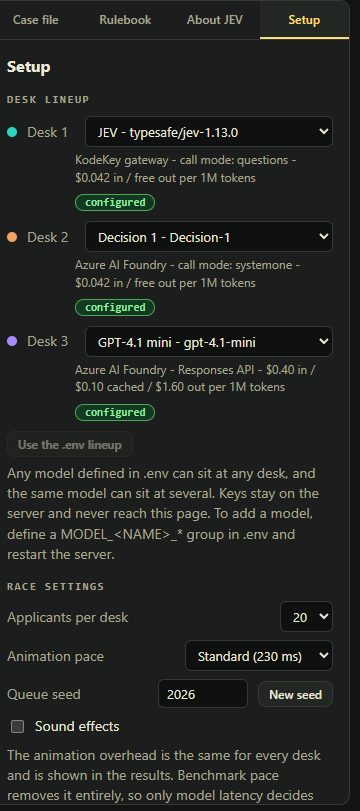

# AI Model Speed Race

**A game that compares how fast AI models make decisions.**

Three AI models work through the same queue of approval decisions, side by side, and the first to clear it wins. Inspired by *Papers, Please*, the game measures how fast,
how accurately and at what cost each one gets through the queue. It was built to show what a fast decision model such as **Microsoft Decision 1** or **JEV**
buys you compared with a general-purpose LLM.



*A real race in progress. Every number on screen is measured, not scripted.*

## The idea

Picture a border checkpoint with three desks. At each desk sits an approver backed by a different AI model. Applicants arrive with a short file, and a rulebook of six rules
says to reject anyone who breaks even one. The model reads the file, answers *approve* or *reject*, and the approver stamps it. The model that works through its queue first wins.

Plenty of real business decisions look like this: small, repetitive and rule-based, like expense approvals, claim triage or access requests. When thousands pile up,
every extra second per decision makes the queue longer and the bill bigger. The game makes that visible.

## See it in 60 seconds (no keys needed)

```bash
git clone https://github.com/Kumar-Ashwin-Hubert/ai-model-speed-race.git
cd ai-model-speed-race
npm install
npm run demo
```

Open <http://127.0.0.1:3000> and press **Start shift**. You need [Node.js](https://nodejs.org) 20.12 or newer, and a one-time `npm install`.

> **Demo mode is a simulation.** The models are simulated, with delays modelled on the live runs below, and it says **SIMULATED** everywhere. It shows how the game works; it is not a measurement.
> For real numbers, race the real models.

## Race the real models

You need a KodeKey token (for JEV) and a key for an Azure AI Foundry resource (for Decision 1, GPT and others).

1. Copy `.env.example` to `.env` and paste your keys into it.
2. Run `npm run check` to test every connection with real calls.
3. Run `npm start` and press **Start shift**.

By default the server only listens on your own machine. Hosting it for other people to use is also supported, with server-enforced daily race limits so costs stay bounded; see [running a protected public demo](docs/setup.md#3-run-it-as-a-protected-public-demo).

Your keys stay in `.env` on your machine; the page never sees them. The full walkthrough is in **[Setup and configuration](docs/setup.md)**.
A 20-applicant race makes about 60 small requests. In our runs 20 decisions cost about $0.0004 with JEV, $0.0002 with Decision 1 and $0.002 with GPT-4.1 mini.
A reasoning model costs much more per decision, because its reasoning tokens are billed as output.
Tokens come from each response, and cost from the provider's own figure or a built-in list price; see [how cost and tokens are measured](docs/setup.md#how-cost-and-tokens-are-measured).

## What we measured

Three real races on 13 and 14 October 2026 (the reasoning-model race is from 14 October), all on the same queue ([seed 2026](docs/how-it-works.md#queue-seed), 20 applicants per desk, default pace).
In each one Decision 1 and JEV raced a different rival at the third desk, from a small fast LLM up to a reasoning model.

| Rival at the third desk | Rival's average decision | Decision 1 | JEV |
| --- | --- | --- | --- |
| GPT-4.1 mini (small, fast LLM) | 885 ms | 574 ms, **1.5x** faster | 680 ms, **1.3x** faster |
| GPT-4.1 (large general-purpose LLM) | 1.32 s | 493 ms, **2.7x** faster | 657 ms, **2.0x** faster |
| Grok 4.7 (reasoning LLM, default settings) | 8.20 s | 476 ms, **17.2x** faster | 513 ms, **16.0x** faster |

Every desk got every applicant right in every race, so the extra size and extra thinking bought no accuracy on this task. What it cost is time:
**the more a model deliberates, the bigger the gap.**



*The reasoning-model race after 17 seconds: Decision 1 and JEV have cleared their queues; Grok 4.7 has handled 2 applicants.*



Decision 1 cleared the queue in 14.5 s and JEV in 15.3 s. Grok 4.7 needed 2 minutes 49 seconds for the same decisions, about 8 s each. It reasons in text before it answers
(around 330 tokens per decision), while a decision model scores all six rules in one parallel pass. Decision 1 and JEV finish within a couple of seconds of each other,
so either can be first on a given run; both stay far ahead of Grok 4.7.
*Cleared in* includes a fixed 230 ms of animation per applicant for every desk, so it understates the gap; *average decision* is pure model time.

<details>
<summary>The small-model race in detail (GPT-4.1 mini)</summary>

| Approver | Cleared in | Average decision | P95 | Accuracy |
| --- | --- | --- | --- | --- |
| Decision 1 | 16.4 s | 574 ms | 936 ms | 100% |
| JEV | 18.5 s | 680 ms | 877 ms | 100% |
| GPT-4.1 mini | 22.6 s | 885 ms | 940 ms | 100% |



Against a small model that is already quick at answering one word, the gap is real but modest: every call also pays for the network.

</details>

More, including the large-model race and the method, in [About the models](docs/about-the-models.md).

## Right tool for the right job

Decision models like JEV and Decision 1 are built for decisions that are **bounded, repetitive and rule-based**: an application, claim or request goes in, and an approve, reject or score comes out.
That is exactly the job in this game, which is why they win here. Treat it as a best case, not a general verdict.

- **Good fit:** approvals, triage, routing, flagging and compliance checks with clear criteria, at high volume, where speed and cost per decision matter.
- **Poor fit:** open-ended questions, writing, multi-step reasoning, explanations, or anything that needs arithmetic, dates or counting (documented weak spots of JEV). That is where a reasoning LLM earns its time.

## Why you can trust the numbers

- **Same applicants, same order.** Every desk gets an identical queue, and a seed lets you replay it.
- **Hidden answers.** Each applicant has a right answer the models never see. Accuracy is scored against it, including wrongly approved cases.
- **Measured where it counts.** Time is taken on the server around each model call. Retries count, because the approver really waited; warm-up does not.
- **No gaming it.** A desk that errors out stops and is never ranked, so failing fast cannot win.
- **Shareable results.** Export the full report as JSON.

## Make it your own

- Pick any model for any desk in **Setup, Desk lineup**: Decision 1, JEV, GPT-4.1, Grok 4.7, or one you add in `.env`.
- Try 30 or 50 applicants and **Benchmark** pace (no animation) to see pure model speed.
- Reasoning models are slow by design: Grok 4.7 took about 2 minutes for 20 applicants, so choose 10 applicants for a quicker race.
- Reuse a seed to replay the exact same queue after changing the line-up.



## FAQ

**Is this a benchmark?** No. It is a demonstration on one small, synthetic task. It shows speed, accuracy and cost on that task and does not rank the models in general.

**Why isn't the gap 40-200x, like some vendor claims?** Those figures describe the model alone, in other comparisons. In this game every call also pays for the network, and the rival decides how big the gap is:
about 1.3x to 1.5x against a small LLM, 2x to 2.7x against a large one and 11x to 13x against a reasoning model in our runs. Try your own rival in **Setup**, and see [About the models](docs/about-the-models.md).

**Do the models see the right answers?** No. They only get the applicant's file.

**Why "Checkpoint One"?** It is the in-game name of the border post where the race takes place.

**Is it safe to run?** By default the server listens on your machine only, keeps your keys to itself and ignores any URL or key a page sends. It can also be hosted publicly without a login, with server-enforced daily race limits so anonymous usage can't run up an unbounded bill; see [How it works](docs/how-it-works.md#security-notes) and [running a protected public demo](docs/setup.md#3-run-it-as-a-protected-public-demo).

**Something broke.** See [Troubleshooting](docs/troubleshooting.md).

## Learn more

- [Setup and configuration](docs/setup.md)
- [How it works](docs/how-it-works.md)
- [About the models](docs/about-the-models.md)
- [Troubleshooting](docs/troubleshooting.md)

## Credits

Inspired by *Papers, Please* by Lucas Pope; this project is not affiliated with it. JEV is a model from TypeSafe AI and Microsoft Decision 1 is a Microsoft model.
Their performance claims are the vendors' own; the numbers above are measured by this game.
