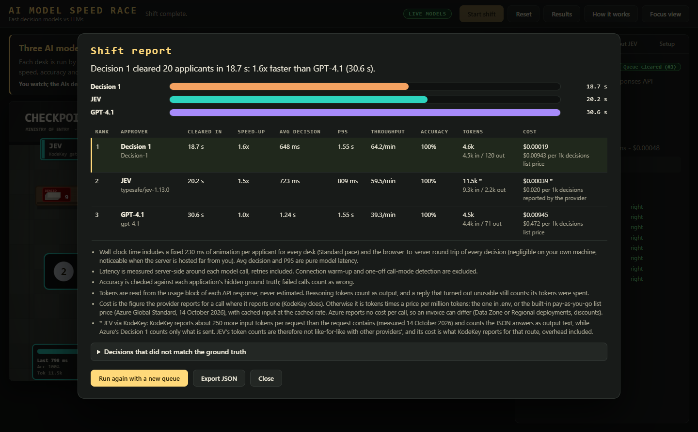

# About the models

[Back to the overview](../README.md)

## What "System One" models are

Most AI models people use are LLMs: they read a prompt and write text. A **System One** model works differently. It does not write.
You send it a description of the situation (the *state*) and a list of typed questions (yes/no "Noul" questions, multiple choice, scores), and it returns
a probability and a calibrated confidence for every question, all answered in parallel in a single pass. Your own code turns those numbers into a decision.

That makes it fast and cheap for bounded, repetitive decisions, and a poor fit for open-ended work. In this game, **JEV** and **Microsoft Decision 1** play that role.

## JEV (research summary)

- **What:** the first "System One" model from TypeSafe AI (San Francisco, founded 2024 by Diogo Almeida, a ChatGPT co-inventor).
  Limited early access on 15 September 2026; hosted API public since 21 September 2026. Current model: `jev-1.13.0`
  (served by KodeKey as `typesafe/jev-1.13.0`).
- **How:** it does not generate text. You send a `state` and typed questions (`choice`, `score`, `noul`); it returns probabilities
  and a calibrated confidence for each, evaluated in parallel in one pass. Adding questions barely changes latency.
- **Vendor claims:** 70-500 ms end-to-end, 40-200x faster and 40-400x cheaper than frontier LLMs on comparable tasks,
  $0.042 per million input tokens with free output, zero format errors. These come partly from TypeSafe's own workflows.
- **Limits (from TypeSafe's own docs and coverage):** roughly mid-tier LLM accuracy on its 4-workflow benchmark (about 68%);
  reads questions literally; weak at arithmetic, dates, counting and multi-hop reasoning; gives numbers, not explanations;
  not for chat or text generation.

## Microsoft Decision 1

A Microsoft model in the same class, available on Azure AI Foundry with the same request shape: you send a `state` and typed questions (`noul`, `choice`, `score`)
and get calibrated probabilities back, with no explanations. The game calls `POST <resource endpoint>/providers/microsoft/v1/systemone` with `model` set to your **deployment name**.
Microsoft documents it in [Deploy and use Microsoft-Decision-1](https://learn.microsoft.com/en-us/azure/foundry/foundry-models/how-to/use-foundry-models-microsoft-decision).

## Vendor claims versus what this game measured

The vendor figures describe the model itself. This game measures what a caller actually experiences: the model **plus** the network round trip (and, for JEV, the KodeKey gateway hop).

Average decision time in live runs on 13 October 2026 (one Foundry resource, the KodeKey gateway and a regular internet connection; runs of 10 to 20 applicants):

| Model | Type | Average decision | Accuracy |
| --- | --- | --- | --- |
| Decision 1 | System One | 0.49 to 0.71 s | 100% in every run |
| JEV (via KodeKey) | System One | 0.48 to 0.74 s | 100% in every run |
| GPT-4.1 mini | small, fast LLM | 0.89 to 1.01 s | 100% in every run |
| GPT-4.1 | large general-purpose LLM | about 1.3 s | 100% |
| Grok 4.7 | reasoning LLM, default settings | about 6 s | 100% |

### The rival decides the gap

Three races on the same queue ([seed 2026](how-it-works.md#queue-seed), 20 applicants, default pace), each pitting Decision 1 and JEV against a different rival:

| Rival | Rival's average decision | Decision 1 | JEV |
| --- | --- | --- | --- |
| GPT-4.1 mini | 885 ms | 574 ms (1.5x faster) | 680 ms (1.3x faster) |
| GPT-4.1 | 1.32 s | 493 ms (2.7x faster) | 657 ms (2.0x faster) |
| Grok 4.7 | 6.07 s | 556 ms (10.9x faster) | 477 ms (12.7x faster) |

The reasoning-model race, with its report, is in the [README](../README.md#what-we-measured).

### Why the gap opens up against bigger models

1. **Every call pays for the network.** That round trip is the same for every model and sits on top of whatever the model itself needs. It is why the gap is modest against a small, quick LLM.
2. **LLMs answer one token at a time, and reasoning models think first.** Grok 4.7 produced around 330 output tokens per decision, almost all of it reasoning. Decision 1 reported about 6 (one per answer) and JEV about 108.
   A decision model scores every question in parallel in a single pass instead of generating text. JEV's 108 is not generated text: KodeKey counts the JSON text of the six answers it returns
   (see [why JEV and Decision 1 report different token counts](setup.md#why-jev-and-decision-1-report-different-token-counts)).
3. **The task is a good fit.** Six literal rules, no arithmetic: the kind of bounded, repetitive decision these models are built for. All five models got all 20 applicants right in these races,
   so the extra deliberation bought no accuracy here. A task that needs open-ended or multi-step reasoning would be a different story.

What we did not see: the vendors' larger claims (40 to 200x). The widest gap we measured was about 13x, against a reasoning model.

### How the large-model races were run

- Grok 4.7 ran at its **default reasoning effort**, with the game's default 4,096-token cap and 60 s timeout. No call failed, and none came near those limits.
- **Reasoning tokens count as output tokens.** Grok reports them separately from `completion_tokens`, so the game adds them when the provider's totals show they are separate (and never double counts providers that already include them).
- **Token counts are not comparable between providers, and they are not costs.** For the same application and the same six questions, JEV through KodeKey reports about twice the input tokens of Decision 1 or an LLM
  (about 460 against about 220), because KodeKey adds a fixed overhead to every request, not because the questions are long. Both list $0.042 per million input tokens with free output, so JEV costs about twice as much per decision here
  only because of that overhead. See [why JEV and Decision 1 report different token counts](setup.md#why-jev-and-decision-1-report-different-token-counts).
  The game shows a cost for every model, worked out from the token counts in each response and the provider's own price or a built-in list price.
  See [how cost and tokens are measured](setup.md#how-cost-and-tokens-are-measured); `.env` prices override the built-in ones.
- Your network, region and deployments will move these numbers. That is what the game is for: change the rival in **Setup**, use 30 to 50 applicants and **Benchmark** pace, and run it a few times.

## Sources

- [TypeSafe announcement](https://typesafe.ai/blog/introducing-system-one-models-and-jev)
- [TypeSafe docs](https://docs.typesafe.ai/introduction)
- [jev-1.13 jaggedness](https://docs.typesafe.ai/model-jaggedness/jev-1.13)
- [DataCamp](https://www.datacamp.com/blog/system-one-models-jev)
- [Wikipedia](https://en.wikipedia.org/wiki/Jev_(AI_model))
- [Microsoft Learn: Deploy and use Microsoft-Decision-1](https://learn.microsoft.com/en-us/azure/foundry/foundry-models/how-to/use-foundry-models-microsoft-decision)
