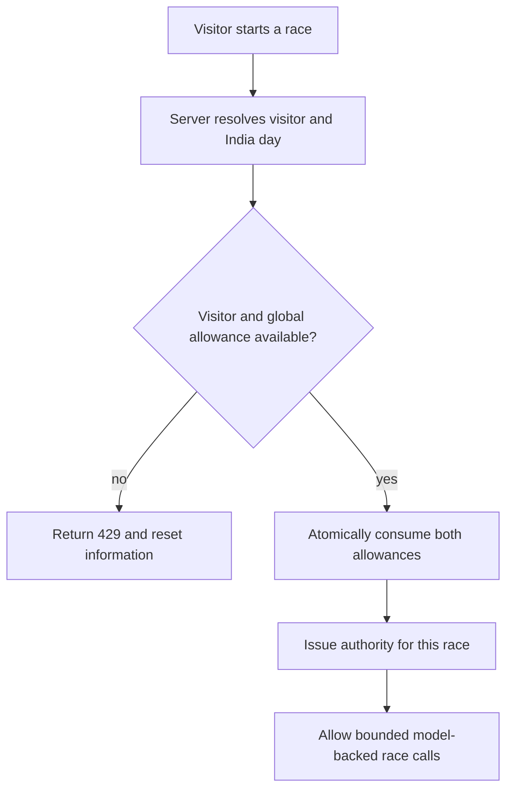
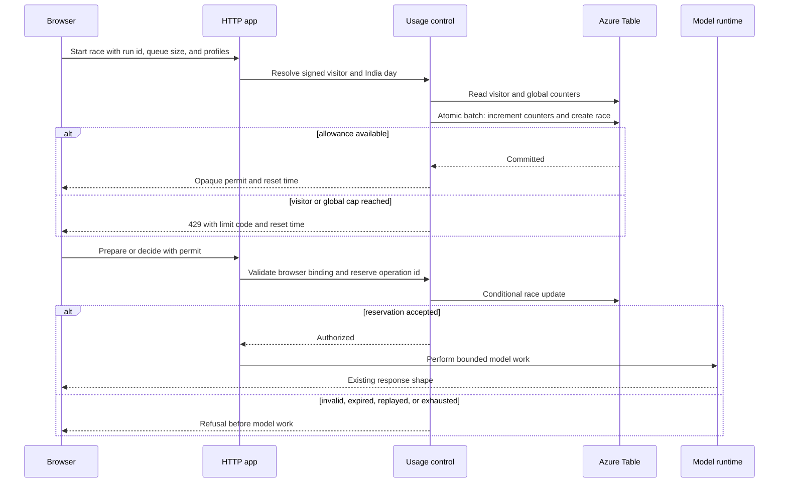

# Anonymous Race Usage Control - Plan

## Goal Capsule

- **Objective:** Keep the public demo available without login while limiting each anonymous visitor to 10 races per India-calendar day and bounding the app's total daily model spend.
- **Product authority:** The server is authoritative for allowances; browser-only controls and Azure budget alerts are secondary safeguards.
- **Open blockers:** None. Storage, permit-budget, and deployment mechanics are resolved in the Planning Contract below.

## Product Contract

### Summary

Add server-enforced anonymous race permits backed by shared persistent counters.
Each visitor receives up to 10 race starts per India-calendar day, and a configurable app-wide daily cap stops new races before total usage exceeds the operator's chosen ceiling.

### Problem Frame

The published app exposes model-backed operations without requiring users to identify themselves.
Client-side controls can be bypassed, request-based throttles do not correspond to complete races, and per-process counters cannot reliably bound spend across restarts or multiple App Service instances.

### Key Decisions

- **Count races rather than raw requests.** A visitor allowance represents understandable demo sessions even though each race makes multiple model calls.
- **Consume allowance when a race starts.** This prevents abandoned or interrupted races from becoming free paths around the quota.
- **Reset on the India calendar day.** Visitor and global counters reset at midnight in `Asia/Kolkata`, not on a rolling 24-hour window.
- **Use layered anonymous controls.** A server-recognized browser identity provides the normal allowance, while IP-based burst protection discourages casual automation.
- **Make the global cap authoritative.** The app-wide daily ceiling remains effective even when a visitor evades browser or IP identification.

### Requirements

**Visitor allowance**

- R1. An anonymous visitor may start at most 10 races (the default of `USAGE_VISITOR_DAILY_LIMIT`) during one `Asia/Kolkata` calendar day.
- R2. Starting a race consumes one visitor allowance before model-backed work begins.
- R3. An allowed race receives server authority for only that race and cannot authorize unlimited or unrelated model calls.
- R4. Clearing browser state or changing network identity is not promised to preserve or recover an allowance.

**Global cost control**

- R5. A configurable app-wide cap limits the total number of races started during one `Asia/Kolkata` calendar day.
- R6. The server atomically refuses a new race if either its visitor allowance or the global daily allowance is exhausted.
- R7. Daily usage state survives application restarts and remains consistent when more than one application instance serves requests.

**Protected model usage**

- R8. Every public API path capable of spending model credits is governed by an allowed race or an explicitly bounded operational allowance.
- R9. Direct API calls cannot bypass the controls by omitting the browser UI or calling individual decision endpoints.
- R10. Short request bursts from one network source are throttled independently of the daily race allowance.

**User experience and operations**

- R11. A refused request returns HTTP `429` and distinguishes a visitor-limit refusal from an app-wide-limit refusal.
- R12. The UI tells a limited visitor that no new race can start and shows when usage resets at the next India midnight.
- R13. Operators can change the app-wide daily cap through deployment configuration without modifying code.
- R14. Usage-control failures are observable so operators can distinguish quota refusals, storage failures, and upstream model failures.

### Key Flow

### Acceptance Examples

- AE1. **Covers:** R1, R2, R6  
  **Given:** A visitor has started nine races today  
  **When:** The visitor starts another race  
  **Then:** The tenth race is allowed and consumes the final visitor allowance

- AE2. **Covers:** R1, R11, R12  
  **Given:** A visitor has started ten races today  
  **When:** The visitor attempts another race before the next India midnight  
  **Then:** The server returns `429` and the UI explains when the allowance resets

- AE3. **Covers:** R5, R6, R11  
  **Given:** The app-wide daily cap is exhausted  
  **When:** Any visitor attempts to start a race  
  **Then:** The server returns `429` without starting model-backed work

- AE4. **Covers:** R2, R7  
  **Given:** A race allowance was consumed and the app restarts  
  **When:** The same visitor returns during the same India-calendar day  
  **Then:** The consumed allowance remains counted

- AE5. **Covers:** R8, R9  
  **Given:** A caller has no valid authority for an allowed race  
  **When:** The caller invokes a model-spending endpoint directly  
  **Then:** The server refuses the call before contacting a model provider

- AE6. **Covers:** R6  
  **Given:** Only one global race allowance remains  
  **When:** Two start requests arrive concurrently  
  **Then:** Exactly one race starts and the other receives `429`

### Scope Boundaries

- No user accounts, login flow, subscriptions, or paid tiers.
- No guarantee of identifying one physical human across browsers, devices, or changing IP addresses.
- Azure edge throttling and cost alerts may supplement the feature but do not replace server-side race accounting.
- The feature limits new application usage; it does not replace provider-side quotas or Azure spending alerts.

### Dependencies and Assumptions

- All model-spending traffic continues to pass through the application server.
- A shared persistent store with atomic counter semantics is available to the deployed application.
- The app-wide daily cap will be selected by the operator during deployment.

### Outstanding Questions

No blocking questions remain.
The planning-owned storage, permit-budget, and connection-test decisions are resolved in the Planning Contract.

---

## Planning Contract

### Product Contract Preservation

The Product Contract's requirements, acceptance examples, and scope boundaries are unchanged.
Its three planning-owned questions are resolved below.

### Key Technical Decisions

- KTD1. **Persist counters in Azure Table Storage.** The workload is a low-volume key/value ledger, and Table Storage is materially cheaper and simpler for this app than operating Redis. The visitor counter, global counter, and race record share the India-day partition so one entity group transaction can create or update them atomically.
- KTD2. **Use optimistic concurrency for every finite allowance.** Conditional entity updates and bounded retries prevent concurrent requests from consuming the same final visitor, global, preparation, or decision slot.
- KTD3. **Authenticate storage with the App Service managed identity.** Production uses `DefaultAzureCredential` and grants `Storage Table Data Contributor` at table scope. Local development may use an explicit development connection string, but no storage credential is sent to the browser or committed.
- KTD4. **Use opaque, browser-bound race permits.** A start request receives a random, short-lived permit whose hash is stored with the race record. The server also binds that record to a signed anonymous visitor cookie, so a copied permit is not sufficient from another browser identity.
- KTD5. **Reserve spend before contacting a provider.** Preparation and decision allowances are consumed before the runtime can call a model. Provider errors do not refund allowance because they may still incur cost and automatic refunds create replay paths.
- KTD6. **Bound permits to the requested race shape.** The start request records the validated model profiles, desk count, and queue size. The maximum decision count is `queue size x active desks`, which preserves current 10/20/30/50-paper races without granting unrelated API access.
- KTD7. **Fail closed when usage state is unavailable.** An enabled deployment returns a service error before model work if Table Storage cannot authorize or reserve usage. Availability does not take precedence over the cost ceiling.
- KTD8. **Keep burst throttling secondary and local.** A small per-IP start limiter absorbs obvious bursts, while persistent visitor and global counters remain authoritative. In App Service only, the helper trusts the platform-supplied client-address chain, normalizes IPv4/IPv6, and immediately applies a day-scoped keyed HMAC; local mode uses the socket peer and never trusts caller-supplied forwarding headers.
- KTD9. **Remove the paid diagnostics surface from the public live app.** When live usage control is enabled, the UI omits connection testing and `/api/test` is unavailable. `npm run check`, local live mode without usage control, and mock mode retain their current diagnostics.
- KTD10. **Preserve current behavior unless usage control is explicitly enabled.** Local demo and existing tests do not require Azure resources. An enabled but incomplete usage-control configuration fails startup with a specific configuration error.
- KTD11. **Make race creation and operation reservation idempotent.** The browser supplies one random run identifier per Start action and one stable operation identifier per preparation/decision. Repeating the same identifier returns or recognizes the existing reservation without incrementing counters or starting a second runtime operation; retries internal to the first runtime operation remain governed by the existing retry policy.
- KTD12. **Apply global-cap decreases immediately and increases on the next India day.** The daily global row records the lowest configured cap observed that day. Restarts or scale-out instances may lower that ceiling, including to zero for an emergency stop, but cannot raise it until the next partition prevents mixed deployments from widening exposure.

### High-Level Technical Design

**Daily table shape**

| Partition key | Row key | Purpose |
|---|---|---|
| India date, such as `20261014` | `global` | App-wide races consumed and lowest configured ceiling observed that day |
| Same date | `visitor:<day-scoped hash>` | This anonymous browser's races consumed |
| Same date | `race:<random id>` | Permit hash, visitor binding, expiry, allowed profiles, preparation state, decision limit, and decisions consumed |

The anonymous visitor hash is day-scoped so stored rows cannot link the same browser across multiple days.
The browser keeps its signed visitor cookie between visits, but keeps an active race permit only in memory.
Race permits expire at the earlier of a fixed maximum lifetime or the next India midnight.
Race rows use a deterministic identifier derived from the visitor and client run identifier so a retried Start request recovers the same permit without consuming another race.
Preparation and decision operation identifiers are recorded with the race so transport retries are recognized before another runtime operation starts.

### Configuration Contract

| Setting | Behavior |
|---|---|
| `USAGE_CONTROL_ENABLED` | Defaults to `false`; enables all persistent quota and permit checks when `true` |
| `USAGE_DAILY_GLOBAL_RACES` | Required non-negative integer when usage control is enabled; `0` is the fail-closed emergency stop |
| `USAGE_VISITOR_DAILY_LIMIT` | Optional whole number from 1 to 1000, default 10; invalid values fail startup when usage control is enabled |
| `USAGE_TABLE_ENDPOINT` | Required production Table service endpoint |
| `USAGE_TABLE_NAME` | Defaults to `RaceUsage` |
| `USAGE_STORAGE_CONNECTION_STRING` | Optional local-development alternative; rejected when App Service environment markers are present |
| `USAGE_SIGNING_SECRET` | Required stable secret for visitor-cookie integrity and day-scoped hashes |
| `USAGE_PERMIT_MINUTES` | Bounded race lifetime with a conservative default that accommodates reasoning-model races |
| `USAGE_STARTS_PER_MINUTE` | Best-effort per-IP race-start burst ceiling |

The visitor allowance defaults to `10` and is an operator setting (`USAGE_VISITOR_DAILY_LIMIT`). Unlike the global cap it needs no lowest-of-the-day memory: it is compared with each visitor's count on every start, so a change applies from the next start in both directions while the global cap still bounds total exposure.
Public configuration exposes only whether usage control and connection testing are available, the visitor allowance, and reset information.
It never exposes storage settings, secret material, raw visitor identifiers, IP addresses, or permit hashes.
Signing-secret rotation occurs at India midnight or during a public maintenance window; rotating it mid-day intentionally invalidates visitor cookies and active permits, so the global cap remains the backstop.

### Error Contract

| HTTP status | Code | Meaning |
|---|---|---|
| `401` | `race_permit_required` | A spending route was called without a permit |
| `403` | `race_permit_invalid` | The permit is malformed, expired, belongs to another visitor, or does not allow the requested race shape |
| `409` | `race_operation_replayed` | Preparation has already been consumed for this race |
| `429` | `visitor_daily_limit` | This browser has started its daily allowance of races (10 by default) |
| `429` | `global_daily_limit` | The deployment's global race ceiling is exhausted |
| `429` | `start_rate_limit` | The best-effort IP burst ceiling is exceeded |
| `503` | `usage_control_unavailable` | Persistent authorization could not be completed safely |

Every limit response includes a stable code and the next India-midnight reset timestamp when applicable.
Logs include the code, India day, and race identifier prefix but exclude secrets, full identifiers, permits, cookies, request dossiers, and raw IP addresses.
Permit-bearing responses are `Cache-Control: no-store, private`, and permits travel only in the response body and a dedicated request header, never in URLs, cookies, or logs.

### Alternatives Considered

- **In-memory counters:** Rejected because deploys, restarts, and scale-out would reset or split the authoritative totals.
- **Azure Managed Redis:** Technically strong for atomic counters and expiry, but disproportionate recurring infrastructure for this demo's expected volume.
- **Azure Front Door/WAF as the source of truth:** Useful as an optional outer shield, but it counts requests rather than races and cannot bind all model calls to one allowance.
- **Cookie/IP quotas without race permits:** Rejected because callers could invoke `/api/decide`, `/api/prepare`, or `/api/test` directly and bypass a Start-button limit.

### System-Wide Impact

- **Browser:** Race startup becomes an authorization step before connection preparation. Limit responses must leave the race ready rather than partially started.
- **HTTP API:** A new race-start route is introduced; preparation and decision routes require a valid permit when control is enabled; the live public test route is removed.
- **Runtime:** Provider code remains unchanged. Authorization completes before `runtime.prepare` or `runtime.decide` is entered.
- **Operations:** The App Service gains a managed identity, table-scoped RBAC, a Table Storage dependency, and non-secret quota settings plus one stable signing secret.
- **Documentation:** Hosted deployment guidance must no longer claim that the app should never be public; it must distinguish protected hosted mode from the default local-only mode.

### Risks and Mitigations

- **Hot global row:** Every start updates one row in the daily partition. The configured demo cap keeps this volume low; bounded ETag retries handle ordinary contention. Sustained conflicts surface as `503` rather than allowing an uncounted race.
- **Different race sizes and retries:** One 50-paper, three-desk race has 150 logical decisions, and the current maximum of five retries permits up to 900 provider attempts plus bounded preparation probes. The global race ceiling is a race-count ceiling, not a currency ceiling; operators size it from this worst case and retain provider quotas and Azure budget alerts.
- **Cookie or IP rotation:** Anonymous visitor enforcement is deterrence, not identity. The global daily cap remains the hard exposure ceiling.
- **Capacity exhaustion:** A determined anonymous attacker can consume the shared daily pool and deny later visitors. This availability trade-off is accepted for the no-login demo; the emergency response is to lower the daily ceiling to zero, block abusive traffic at the Azure edge, or temporarily restrict public access.
- **Storage growth:** Daily partitions retain pseudonymous usage records. Day-scoped hashes reduce linkability; operational documentation must define a retention and cleanup policy before long-term production use.
- **Clock boundaries:** All reset calculations use `Asia/Kolkata` explicitly and tests cover both sides of midnight. Server-local timezone is never authoritative.
- **Configuration drift:** Startup validates required values when enabled, and deployment verification checks identity, RBAC, table access, and the configured global cap before public traffic is enabled.
- **Rollback exposure:** Usage control is never disabled while provider-backed routes remain public. Rollback first sets the effective ceiling to zero or removes public/provider access, then changes application versions.

### Sources and Research

- `server/app.js` — all current public API routing and same-origin enforcement.
- `server/runtime.js` — preparation can probe model APIs, and `/api/test` makes two decisions per configured desk.
- `public/js/race.js` — each desk processes the queue sequentially while desks run concurrently.
- `public/js/main.js` — current browser API calls and race lifecycle integration.
- `README.md` — a 20-paper, three-desk race makes about 60 model requests; the configurable maximum is 50 papers across three desks.
- [Azure Table entity group transactions](https://learn.microsoft.com/en-us/rest/api/storageservices/performing-entity-group-transactions) — same-partition operations are atomic and support conditional updates.
- [Azure Tables JavaScript `TableClient`](https://learn.microsoft.com/en-us/javascript/api/@azure/data-tables/tableclient?view=azure-node-latest) — supports token credentials and `submitTransaction`.
- [Managed identities for App Service](https://learn.microsoft.com/en-us/azure/app-service/overview-managed-identity) — App Service can access Entra-protected resources without stored Azure credentials.
- [Azure roles for Table data](https://learn.microsoft.com/en-us/azure/storage/tables/assign-azure-role-data-access) — `Storage Table Data Contributor` can be scoped to one table.
- Azure Resource Manager inspection on 2026-10-14 — the current deployment is the running Basic Linux App Service `ai-model-speed-race` in Central India; deployment instructions remain parameterized so they are portable to another app.

---

## Implementation Units

### U1. Usage-control configuration and Azure client wiring

**Goal:** Add validated configuration and construct the usage service without changing default local behavior.

**Requirements:** R7, R13, R14; KTD3, KTD10

**Dependencies:** None

**Files:**

- `package.json`
- `package-lock.json` (new)
- `server/config.js`
- `server.js`
- `.env.example`
- `test/config.test.js`

**Approach:**

- Add the Azure Tables and Azure Identity SDK dependencies using the existing npm ecosystem.
- Parse the Configuration Contract with bounded numeric validation and cross-field checks; keep the visitor allowance defaulting to 10 with a bounded whole-number override.
- Keep usage control disabled by default; when enabled, require a global cap, table endpoint or explicit local connection string, and signing secret. Reject connection-string authentication when App Service environment markers are present.
- Construct one table client and one usage-control service at startup, inject it into `createApp`, and verify table access before listening so a protected deployment cannot start in a false-safe state.
- Keep mock mode and local development operational without Azure configuration.

**Patterns to follow:** Reuse `server/config.js` parsing helpers, startup error propagation in `server.js`, and secret-free `publicConfig`.

**Test scenarios:**

1. Empty/default configuration leaves usage control disabled and preserves current public configuration.
2. A fully specified enabled configuration parses the global limit, permit lifetime, table target, and burst ceiling while retaining the fixed visitor limit of 10.
3. Enabled configuration rejects a missing global cap, negative cap, missing signing secret, missing storage target, invalid table name, and out-of-range numeric settings; zero remains a valid emergency stop.
4. Public configuration includes safe usage flags and values but excludes the signing secret, connection string, and table credential details.
5. Startup propagates table initialization or authentication failure instead of listening with usage checks bypassed.
6. App Service startup rejects `USAGE_STORAGE_CONNECTION_STRING` and requires managed-identity configuration.

**Verification:** The server starts unchanged in demo/default mode and refuses to start when protected mode is incomplete or cannot reach its usage store.

### U2. Atomic daily ledger and permit domain service

**Goal:** Implement race allocation and bounded operation reservation against Azure Table Storage.

**Requirements:** R1-R7, R10, R14; AE1-AE4, AE6; KTD1-KTD8

**Dependencies:** U1

**Files:**

- `server/usage.js` (new)
- `server/usage-store.js` (new)
- `test/usage.test.js` (new)
- `test/usage-store.test.js` (new)

**Approach:**

- Separate policy/time/cookie/permit behavior from the Table client adapter so deterministic unit tests use a contract-compatible in-memory fake.
- Compute the India-day partition and next reset from injected time, never from server-local date methods.
- Issue a cryptographically random visitor identifier in a signed, `HttpOnly`, `Secure` hosted-mode, `SameSite=Strict`, path-scoped cookie. Derive a day-scoped storage HMAC rather than persisting the cookie value.
- Allocate a race by point-reading the daily global and visitor rows, validating both caps, then atomically updating those rows and creating the idempotent race row in one same-partition transaction.
- Derive the opaque race permit reproducibly from the stored race identity and server secret so retrying the same client run identifier returns the same authority without storing plaintext. Bind the race to the visitor hash, selected profiles, queue size, expiry, one preparation reservation, and a maximum decision count.
- Reserve preparation and each decision under a stable operation identifier before returning authorization. Duplicate operation identifiers are rejected or recognized without incrementing counters or starting a second runtime operation. Use ETags with bounded randomized-backoff retries; after a conflict, re-read and re-evaluate the relevant cap.
- Reconcile the daily global row to the lower of its stored ceiling and current configured ceiling; a configured increase applies only to the next India-day partition.
- Add a bounded per-process IP start bucket as a prefilter. Trust App Service forwarding headers only in the App Service environment, otherwise use the socket peer; normalize and apply a day-scoped keyed HMAC immediately.
- Map quota, permit, replay, conflict exhaustion, and storage errors to the stable Error Contract.
- Emit structured allowlisted events for starts, refusals, storage failures, and upstream failures without serializing raw SDK errors, request headers, bodies, cookies, permits, or addresses.

**Execution note:** Implement the pure policy service and concurrency tests before connecting it to the HTTP layer.

**Patterns to follow:** Use dependency injection and clock injection as in `server/runtime.js`; surface typed domain errors rather than broad catches or success-shaped fallbacks.

**Test scenarios:**

1. Covers AE1. The ninth consumed race allows the tenth and consumes the final visitor allowance.
2. Covers AE2. The eleventh race on the same India date is rejected with `visitor_daily_limit` and the correct next reset.
3. A request immediately after India midnight uses a new partition and receives a fresh allowance.
4. Covers AE3. Exhausted global allowance rejects every visitor without creating a race row.
5. Covers AE4. Reconstructing the service against the same store preserves consumed visitor and global counts.
6. Covers AE6. Two concurrent claims for the final global slot commit exactly one race after ETag conflict handling.
7. Two concurrent claims by the same visitor cannot exceed the visitor limit.
8. A repeated or concurrent Start with the same visitor/day/run identifier returns the same permit and consumes only one visitor/global slot, including when the first response is lost.
9. The start transaction uses one date partition for global, visitor, and race entities and supplies conditional ETags for existing counters.
10. A valid permit authorizes exactly one preparation; repeating its operation identifier is rejected without another runtime invocation or reservation.
11. A permit with a 20-paper, three-desk shape authorizes at most 60 distinct decision operations and rejects the sixty-first.
12. Repeating or concurrently submitting one decision operation identifier cannot consume two slots or authorize a second runtime decision.
13. An expired permit, wrong visitor cookie, altered permit, disallowed profile, and decision after India reset are each rejected.
14. Lowering the configured global cap, including to zero, takes effect against the current daily row; raising it does not take effect until the next India day.
15. Storage authentication, timeout, or exhausted conflict retries produce `usage_control_unavailable` and never authorize work.
16. The IP bucket rejects a burst over its configured threshold, ignores spoofed forwarding headers outside App Service, parses the platform chain consistently, and evicts stale entries without retaining raw addresses.
17. Cookie output has the required security attributes in hosted HTTPS mode and does not mark loopback HTTP development cookies `Secure`.
18. Representative quota, storage, and upstream failures log only allowlisted fields and never serialize raw errors, headers, request bodies, cookies, permits, connection strings, or addresses.

**Verification:** The domain tests prove no visitor, global, preparation, or decision slot can be double-consumed and no storage failure grants authorization.

### U3. Enforce permits at every model-spending HTTP route

**Goal:** Make server-side race allocation the only route to public model calls.

**Requirements:** R2, R3, R6, R8-R11, R14; AE3, AE5, AE6; KTD5, KTD6, KTD9

**Dependencies:** U2

**Files:**

- `server/app.js`
- `server.js`
- `test/app.test.js`
- `test/lineup.test.js`

**Approach:**

- Add `POST /api/races/start`, validating a client run identifier, queue size against the current supported values, and profiles through the existing catalog parser before allocating usage.
- Return the opaque permit and reset timestamp. Set or refresh the signed visitor cookie through the usage service; do not expose global remaining capacity.
- Require the permit header for `/api/prepare` and `/api/decide` only when usage control is enabled. Reserve the appropriate operation before calling the runtime.
- Check that profiles and desk selections match the race record. Keep existing dossier validation and origin protections intact.
- Make `/api/test` unavailable when live usage control is enabled, while preserving it for mock mode and unprotected local mode.
- Preserve existing API behavior when usage control is disabled so local users and existing integrations do not require a permit.
- Return structured Error Contract payloads and `Retry-After` where a reset or burst interval is known.
- Apply `no-store, private` caching to permit and protected-route responses, and accept permits only through a dedicated header.

**Patterns to follow:** Extend `HttpError`, `sendJson`, `parseProfile`, `parseProfiles`, and the existing abort-controller boundary in `server/app.js`.

**Test scenarios:**

1. Disabled usage control preserves existing `/api/prepare`, `/api/test`, and `/api/decide` behavior.
2. An enabled start request accepts each supported queue size and one to three known profiles, sets the visitor cookie, and returns a permit without calling the runtime.
3. Unknown profiles, unsupported queue sizes, malformed run identifiers, malformed JSON, foreign origins, and wrong methods are rejected before allocation.
4. Covers AE5. Missing, invalid, expired, visitor-mismatched, and exhausted permits prevent `runtime.prepare` and `runtime.decide` from being called.
5. A valid permit permits one preparation and the race's bounded sequence of decisions while preserving current response bodies.
6. Repeating preparation returns the replay error and does not call `runtime.prepare` twice.
7. Covers AE3. Visitor, global, and burst limit failures return `429`, stable codes, reset data, and `Retry-After` without runtime calls.
8. Storage failure returns `503 usage_control_unavailable` and does not call a provider-facing runtime method.
9. Live protected mode returns not found for `/api/test`; mock and unprotected local modes retain it.
10. A client disconnect still aborts an authorized in-flight runtime call.
11. Same-origin and DNS-rebinding protections continue to reject hostile requests before any usage allocation.
12. Start and protected responses prevent caching, and permits never appear in URLs, cookies, error messages, or logs.
13. Existing upstream provider failures retain their distinct runtime error classification and remain distinguishable from quota and storage failures in structured logs.

**Verification:** HTTP integration tests demonstrate that no model-spending route reaches the runtime without successful usage reservation.

### U4. Integrate authorization and limit UX into the race lifecycle

**Goal:** Request one permit per Start/Run again action and present actionable daily-limit feedback without corrupting race state.

**Requirements:** R1-R3, R11, R12; AE1, AE2; KTD4, KTD6, KTD9

**Dependencies:** U3

**Files:**

- `public/js/race.js`
- `public/js/main.js`
- `public/js/ui.js`
- `test/race.test.js`

**Approach:**

- Give `Race` an authorization dependency and explicit `authorizing` state that run before warming and carry the returned permit through preparation and every decision call.
- Include the current queue size and selected profile list in the start request. Keep the permit only on the active race token so reset, cancellation, navigation rebuild, and completion cannot accidentally reuse it.
- Generate one run identifier per deliberate Start/Run again action and stable operation identifiers for preparation and each desk/paper decision so transport retries are idempotent.
- Parse structured API failures instead of collapsing them to generic HTTP errors.
- On visitor limit, show that 10 races have been used and the India reset time. On global limit, explain that the public demo has reached today's capacity. On storage failure, report temporary unavailability without implying quota exhaustion.
- Disable Start/Run again while authorization is pending; reset or rebuild aborts or invalidates the request and stale responses cannot start a race. Leave the race in `ready` state after refusal so the user can retry after a transient service error.
- Hide the Connections section's paid test action when public configuration marks it unavailable. Preserve the simulated/local copy and behavior.
- Render limit and service messages through persistent semantic status/error output associated with the triggering control and announced through the existing live region; do not rely on color or a transient toast alone.
- For `start_rate_limit`, remain ready, preserve selections, and show a retry message derived from `Retry-After`.
- If a permit fails after allocation, stop further desk work, clear the permit, preserve completed records, and show a terminal error that requires a new Start.
- Label reset timestamps explicitly as India time (`Asia/Kolkata`/IST) while retaining a machine-readable absolute timestamp.

**Execution note:** Start with race-engine tests for authorization ordering and state transitions, then wire browser fetch and rendering.

**Patterns to follow:** Preserve the existing `Race` event model, abort handling, `toast` path, and DOM-construction helpers in `public/js/ui.js`.

**Test scenarios:**

1. Authorization completes before preparation and all decision calls receive the same active permit.
2. Covers AE1. A successful tenth start enters warming/running.
3. Covers AE2. A visitor-limit response leaves the race ready, runs no preparation or decisions, and exposes the reset message.
4. A global-limit response uses distinct public-demo-capacity wording without revealing configured totals.
5. A `503` authorization failure leaves the race ready and presents a retryable service message.
6. Reset during an active race aborts calls and clears the in-memory permit; the next Start requests a new permit.
7. Run again with a new queue requests and consumes a new race permit.
8. Protected live configuration omits the test-connections control; mock and unprotected configuration still render it.
9. Double activation while authorizing sends one start request; reset/rebuild cancels or invalidates the request and ignores a late success.
10. A burst-limit response remains ready and exposes a keyboard- and screen-reader-accessible retry message based on `Retry-After`.
11. Mid-race permit invalidation stops future work, clears authority, preserves completed records, and requires a new authorized race.
12. Every visitor/global/burst/unavailable message is available through semantic live status, retains sufficient display duration, uses no color-only distinction, and labels reset time as India time.

**Verification:** Race tests prove one authorization per run and no partial start on refusal; a browser smoke test confirms distinct visitor/global/unavailable messages and correct button state.

### U5. Document and deploy protected hosted mode

**Goal:** Make the Azure prerequisites, cost envelope, rollout, and operator response unambiguous.

**Requirements:** R7, R12-R14; KTD3, KTD7, KTD10

**Dependencies:** U1-U4

**Files:**

- `README.md`
- `docs/setup.md`
- `docs/how-it-works.md`
- `docs/troubleshooting.md`
- `.env.example`

**Approach:**

- Update dependency/setup instructions now that npm packages are required.
- Document local unprotected mode, mock mode, and protected hosted mode separately.
- For the existing `ai-model-speed-race` Linux App Service in Central India, document creating or reusing a Standard LRS storage account, creating the usage table, enabling system-assigned identity, and granting `Storage Table Data Contributor` at table scope.
- Document every usage setting, India-midnight semantics, 150 logical decisions and up to 900 configured retry attempts plus preparation probes per maximum race, and how to choose the global cap from worst-case exposure.
- Document the rollout order: deploy privately or in a staging slot with control disabled, provision identity/table/RBAC, validate access, set the signing secret and caps, enable control, restart or swap, then smoke-test allowance and direct-route refusals before opening public traffic.
- Document fail-closed rollback: lower the effective cap to zero or remove public/provider access first, allow or terminate in-flight races, then roll back code. Never expose provider-backed routes with usage control disabled.
- Document retention for old daily partitions and a manual cleanup procedure until automated retention is intentionally added.
- Recommend an Azure Cost Management budget alert as a final alarm rather than an enforcement mechanism.
- Add troubleshooting for missing RBAC propagation, table access failure, invalid signing configuration, `429` codes, and fail-closed `503` responses.

**Test expectation:** No automated documentation test exists; verify links, environment names, and portal/CLI terminology against the implemented configuration.

**Verification:** A fresh operator can enable or safely roll back protected mode without reading source code, and can distinguish quota exhaustion from storage or provider failure.

---

## Verification Contract

| Gate | Scope | Expected result |
|---|---|---|
| Unit and integration suite | `npm test` | Existing tests and all new usage, concurrency, HTTP, and race lifecycle scenarios pass without real model or Azure calls |
| Repository checks | `npm run check` | Existing real-connection diagnostic behavior remains available to operators; run only in an environment intentionally configured for live calls |
| Local compatibility smoke | `npm run demo` | App starts without Azure usage settings, simulated races and connection tests still work, and no usage cookie/permit is required |
| Protected-mode failure smoke | Local server with usage enabled and an unreachable/fake table target | Startup or authorization fails explicitly; no request reaches a model runtime |
| Azure deployment smoke | Published App Service with managed identity and table access | First race starts, refresh retains the visitor allowance, direct prepare/decide calls without a permit fail, live connection test is absent, and limit responses show the next India reset |
| Concurrency proof | Targeted final-slot tests plus two simultaneous start requests in a non-production table | Exactly one request consumes the final global slot |
| Retry/idempotency proof | Repeated and concurrent Start, prepare, and decision operation identifiers | One quota reservation and at most one runtime invocation occur for each logical operation |
| Secret/privacy inspection | App Service logs, `/api/config`, response headers/bodies, and Table entities | No storage credential, signing secret, raw cookie identifier, full permit, raw IP, model key, or dossier is exposed |

The real `npm run check` command spends model credits and is not part of routine automated verification.
Azure smoke tests must use a deliberately low temporary global cap or a non-production table and restore the intended value afterward.

---

## Definition of Done

- All R1-R14 requirements and AE1-AE6 acceptance examples are covered by the implementation units and passing tests.
- Usage control is opt-in locally but enabled and correctly configured on the published App Service.
- Visitor and global race allocation is one atomic same-partition transaction with proven final-slot concurrency behavior.
- Retried Start, preparation, and decision operations are idempotent and cannot double-consume quota or start duplicate runtime work.
- Preparation and every decision reserve usage before any provider-facing runtime method is called.
- A permit cannot exceed its race's validated queue/profile shape, survive its expiry/reset boundary, or transfer to another visitor cookie.
- Protected live mode has no public paid connection-test route or control.
- Visitor limit, global limit, burst limit, invalid permit, and storage outage have distinct stable responses and user-facing behavior.
- Local mock mode, unprotected local live mode, existing race results, cancellation, and provider behavior remain intact.
- Managed identity and table-scoped RBAC are active; no Azure Storage account key is stored in App Service configuration.
- Documentation covers setup, configuration, worst-case cost sizing, retention, monitoring, troubleshooting, and rollback.
- Logs and persisted rows meet the privacy/secret inspection gate.
- Product Contract preservation is documented and no blocking open question remains.
